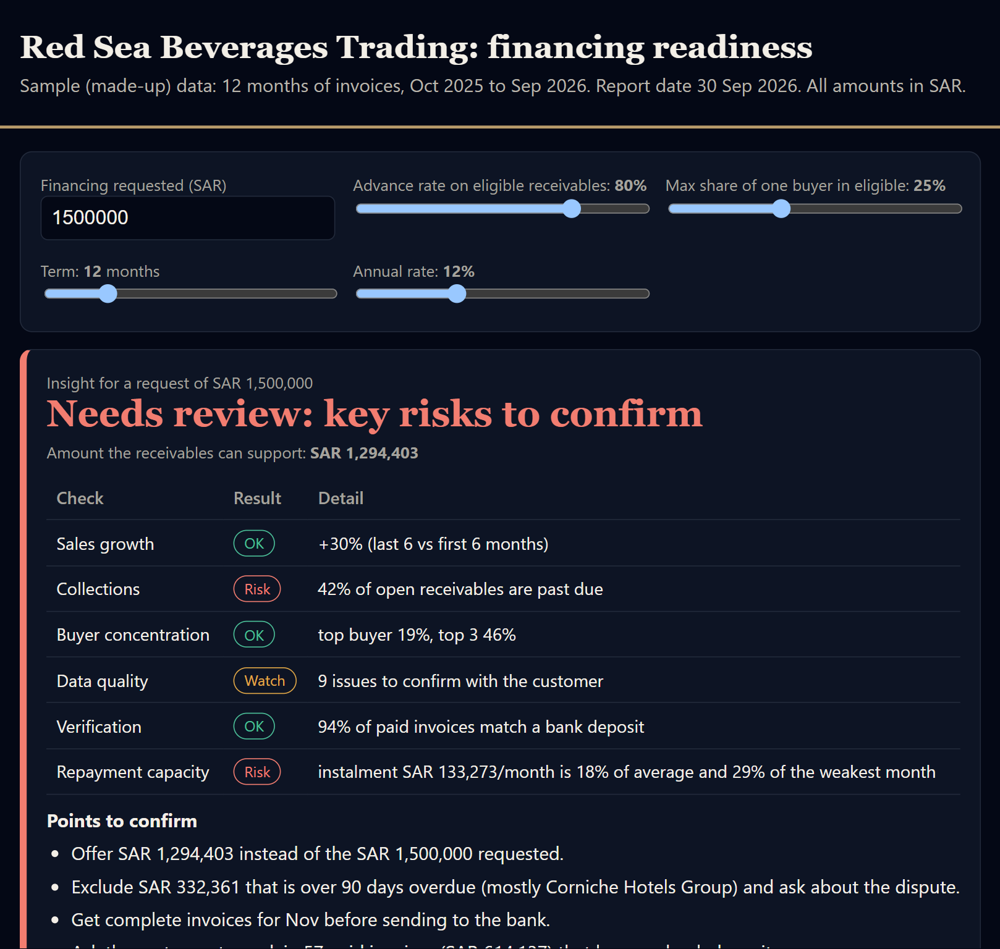
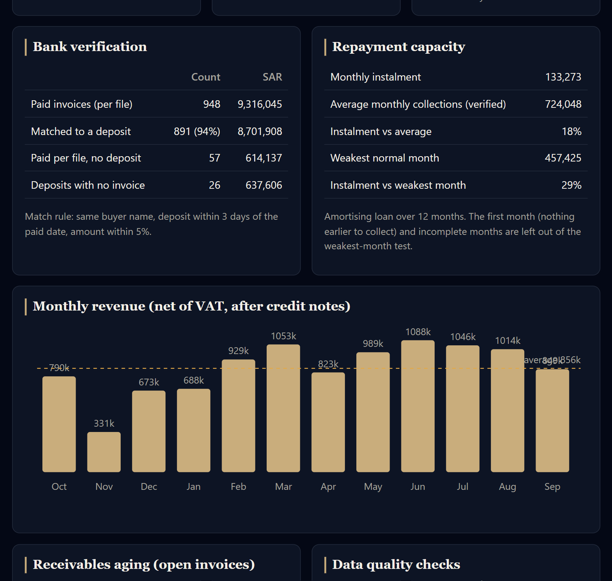
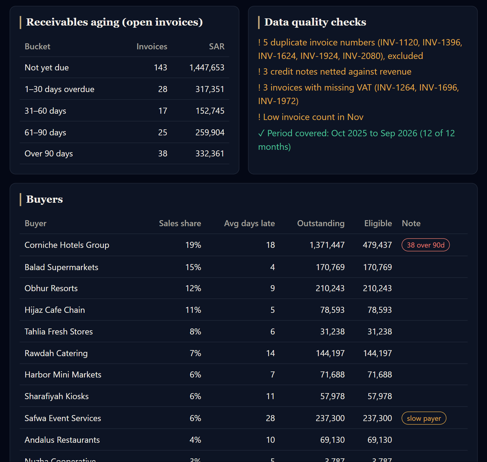
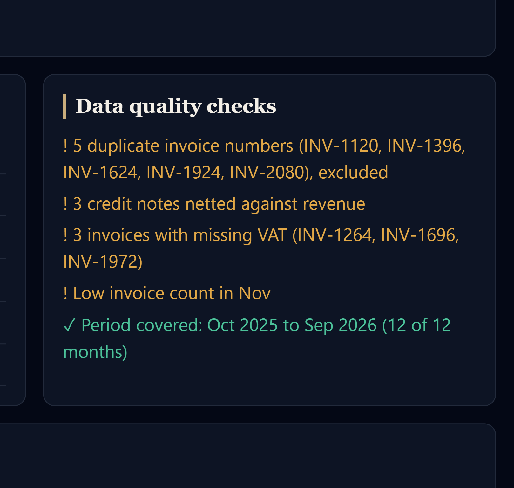

# SME Financing Readiness Dashboard


A small dashboard that turns a wholesaler's 12 months of invoices and bank deposits into a clear,
evidence-based view for a financing decision. It does not approve or reject anyone. It shows the
analyst and the bank what is strong, what is risky, and what to confirm before a decision is made.

---

## The problem

A small wholesaler wants financing. Qawafel collects 12 months of invoices (Excel) and bank
statements (PDF), turns them into a structured package, and sends it to a bank partner.
For that package to be useful, someone must be able to answer three questions quickly:

1. **Is the revenue real?** Do the invoices show up as money in the bank?
2. **Can the business repay?** Does it collect enough cash, even in a weak month?
3. **Where is the risk?** Late payers, one buyer dominating sales, missing or inconsistent data.

This prototype answers those three questions from one page.

## Screenshots


| Overview and scorecard | Bank verification |
|---|---|
|  |  |
| **Receivables aging and buyers** | **Data-quality checks** |
|  |  |

## What the dashboard shows

| Section | What it tells the reader |
|---|---|
| **Insight scorecard** | Six checks, each marked OK, Watch or Risk: sales growth, collections, buyer concentration, data quality, verification, repayment capacity. Below it, a list of *points to confirm*. |
| **Bank verification** | Each paid invoice is matched to a bank deposit. Shows the match rate, paid invoices with no deposit, and deposits with no invoice. |
| **Repayment capacity** | The monthly instalment for the requested amount (term and rate are adjustable), compared with average and weakest-month collections. |
| **Revenue and receivables** | 12-month revenue trend, receivables aging (not due, 1-30, 31-60, 61-90, over 90 days overdue), and an indicative amount the receivables can support. |
| **Buyers** | Share of sales, average days late, amount outstanding, and amount eligible, per buyer. |
| **Data quality** | Duplicate invoice numbers, credit notes, invoices with missing VAT, and months with too few invoices. |

The three controls at the top (amount, advance rate, buyer cap) and the term and rate sliders
recalculate everything instantly.

## How to run

Open `index.html` in any browser. No installation, build step or server is needed.

To regenerate the sample data (requires Node.js, no packages):

```bash
node scripts/generate_data.js
```

## Project structure

```
index.html                  the dashboard (HTML, CSS and the analysis code)
data/invoices.csv           12 months of invoices, 1,207 rows
data/bank_transactions.csv  bank deposits, 917 rows
data/dataset.js             the same data in the form index.html loads
scripts/generate_data.js    creates all of the data above
docs/screenshots/           images used in this README
README.md
```

`index.html` loads `data/dataset.js` with a script tag. This works when the page is opened by
double-click, unlike fetching the CSV files, which browsers block for local files. The two CSV
files are the human-readable copies of the same data.

## The sample data

All data is made up. No real company or customer data is used. The generator uses a fixed random
seed (7319), so every run produces identical files.

**The business.** "Red Sea Beverages Trading", a fictional Jeddah beverage distributor selling to
12 hotels, supermarkets, cafes and caterers. 15% VAT, with payment terms of 30, 45 or 60 days
depending on the buyer. Report date: 30 September 2026.

**Seasonality.** Cold drinks sell more in the summer heat, with peaks for Ramadan and Eid
(Feb-Mar) and the Hajj season (May-Jun), and a slow winter. Growth is about 0.8% a month.

**The risk story.** Sales look healthy, but the largest buyer (a hotel group, about 19% of sales)
leaves many Feb-Jun invoices unpaid, so overdue receivables build up. Two other buyers pay slowly.

**Deliberate errors**, so the checks have something real to find:

- 5 duplicate invoice numbers
- 3 credit notes
- 3 invoices with VAT missing
- an incomplete export for November 2025 (only about 45% of its invoices)

**Bank deposits** are built from the paid invoices, with realistic mess: about 5% are paid in
cash (no deposit), about 7% are paid slightly short, deposits land one day early or late, and 25
deposits belong to no invoice at all (for example owner top-ups).

## How the analysis works

1. **Clean.** Duplicate invoice numbers are excluded. Credit notes reduce revenue but are not
   treated as receivables.
2. **Revenue.** Net amounts (before VAT) are summed per month, and the last six months are
   compared with the first six.
3. **Buyers.** For each buyer: share of sales, average days late on paid invoices, and the amount
   still owed.
4. **Aging.** Every unpaid invoice is placed in a bucket by days past its due date at the report date.
5. **Eligible receivables.** Unpaid, non-duplicate invoices at most 60 days overdue, including VAT.
   No single buyer may exceed a set share of the total (default 25%).
6. **Indicative amount.** Eligible receivables multiplied by the advance rate (default 80%).
7. **Bank matching.** A paid invoice matches a deposit when the buyer name is the same, the
   deposit is within 3 days of the paid date, and the amount is within 5%.
8. **Repayment.** An amortising loan instalment, compared with verified monthly collections.
   The weakest-month test leaves out the first month (nothing earlier to collect) and incomplete months.
9. **Scorecard.** Each check is graded against simple thresholds, and the open issues become the
   list of points to confirm.

## Assumptions and limitations

- **The scorecard thresholds are my own judgement**, for illustration. They are not bank policy.
- **The bank deposits are generated from the invoices**, so the match rate is partly built in.
  It shows that the method works, not what real data would give.
- **Matching by buyer name is simple.** Real statements have messy descriptions, often in Arabic,
  and one deposit can pay several invoices.
- **Payment dates come from the customer's own file.** The bank matching is the check against that.
- **The indicative amount is a starting point for discussion**, not a credit decision.
- **Bank statements are represented as clean transaction rows**, not as real PDF files.
- **A missing match does not necessarily mean an invoice is invalid. Cash payments, partial payments, combined deposits, and differences in transaction descriptions can explain unmatched items. These cases require review before drawing conclusions.

## What I would do next

1. **OCR and parsing of real bank-statement PDFs.** Today the bank data is already structured.
   Real statements arrive as PDFs, often scanned, in Arabic or English, with a different layout at
   every bank. I would:
   - extract text directly from digital PDFs, and use OCR (with Arabic support) for scanned pages;
   - write a parser per bank layout, with tests on sample statements;
   - give every extracted row a confidence score, and send low-confidence rows to a person;
   - check the arithmetic (opening balance + credits - debits = closing balance) so silent
     misreads are caught instead of passed on.
2. **Parse real Excel invoices**, with column mapping for different export formats.
3. **Smarter matching**: one deposit paying several invoices, partial payments, and fuzzy buyer names.
4. **A simpler wholesaler view** for the consent step: the facts about their own data, without the
   assessment.
5. **More signals**: a payment-trend chart per buyer, and fraud-pattern checks such as many round
   numbers or month-end spikes.
6. **Connect data sources** instead of uploads, such as open banking for statements and
   e-invoicing or accounting software for invoices.
